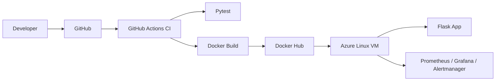

# Flask Azure DevOps Pipeline

Production-style Flask application deployed to Azure with GitHub Actions, Docker, Terraform, and an observability stack.

## Overview

This repository demonstrates a realistic cloud delivery workflow:

1. develop a Flask application
2. validate it with tests
3. package it as a container image
4. publish the image to Docker Hub
5. deploy to an Azure Linux VM
6. monitor the system with Prometheus and Grafana

The goal is to show practical CI/CD, infrastructure as code, and observability skills rather than a toy demo.

## Architecture



## Tech Stack

- Backend: Python, Flask, Pytest
- Containers: Docker, Docker Compose, Docker Hub
- Infrastructure: Terraform, Azure VM
- CI/CD: GitHub Actions
- Monitoring: Prometheus, Grafana, Alertmanager, node_exporter, cAdvisor, blackbox exporter

## Repository Structure

```text
.
├── app.py
├── requirements.txt
├── Dockerfile
├── tests/
├── .github/
│   └── workflows/
├── infra/
│   └── terraform/
│       └── azure/
└── docs/
```

## Getting Started

### Prerequisites

- Python 3.10+
- Docker
- Terraform

### Local development

```powershell
python -m venv .venv
.venv\Scripts\Activate.ps1
pip install -r requirements.txt
pytest -q
python app.py
```

Open:

- `http://127.0.0.1:5000/`
- `http://127.0.0.1:5000/health`
- `http://127.0.0.1:5000/metrics`

### Docker

```powershell
docker build -t benharbfarah/ci_cd_pipeline .
docker run -p 5000:5000 benharbfarah/ci_cd_pipeline
```

## CI/CD

The primary workflow in `.github/workflows/ci-cd.yml` is designed to:

1. run tests
2. validate monitoring configuration
3. build the Docker image
4. push to Docker Hub on `main`
5. redeploy the Azure VM stack

The Terraform workflow in `.github/workflows/terraform-azure.yml`:

1. runs on the self-hosted Azure runner
2. formats and validates Terraform
3. produces a plan for pull requests
4. applies the plan only on manual approval

## Observability

The monitoring stack runs alongside the application on the Azure VM.

- Prometheus scrapes application and host metrics
- Grafana visualizes latency, traffic, and system health
- Alertmanager is ready for notification routing

## Azure Notes

- the VM must be Linux
- the VM must use a system-assigned managed identity
- that identity needs `Contributor` on `myResourceGroupTerraform`
- Grafana is intended to stay private and be accessed through SSH tunneling

## Validation

Typical validation flow:

1. push a change to a feature branch
2. open a pull request and confirm CI passes
3. merge to `main`
4. confirm Docker Hub receives the new image
5. confirm Terraform updates the VM extension
6. verify `/health` and `/metrics`

## Branching and Commits

- Use branches such as `feat/<area>`, `fix/<area>`, `docs/<area>`, or `ci/<area>`
- Keep commits small and focused
- Prefer Conventional Commits such as `ci(github): tighten workflow timeouts`
- Avoid vague messages like `update`, `test`, or `final`

## Contributing

- Open pull requests from feature branches
- Include test evidence or workflow output in the PR description
- Keep infrastructure and application changes separate when possible
- Do not commit secrets or environment-specific values
